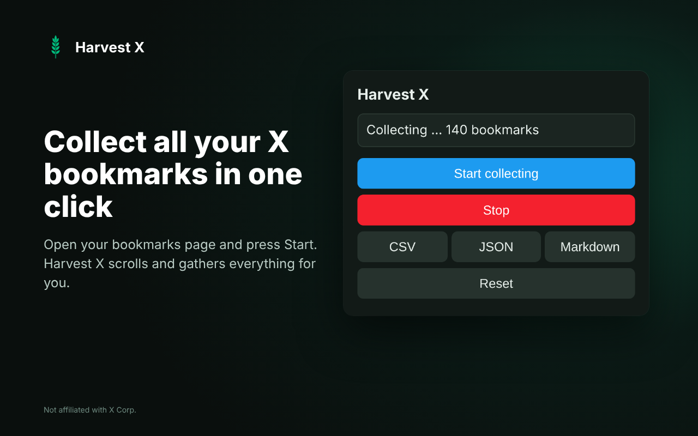

# 🌾 Harvest X

**A lightweight Chrome extension that exports your X bookmarks as CSV, JSON or Markdown.**

> Save your bookmarked posts locally – no more manual copying.

---

## ✨ Features

- 📥 Collects all bookmarks from your X bookmarks page (including infinite scroll)
- 📄 Export as **CSV**, **JSON** or **Markdown**
- ⏹️ Start / Stop collection at any time
- 🔄 Reset collected data
- 🔒 100% local – nothing is sent to any server
- 🎨 Clean, simple popup

## 📦 Installation (Developer Mode)

1. Clone the repository or download it as a ZIP.
2. Go to `chrome://extensions` in Chrome.
3. Enable **Developer mode** in the top right.
4. Click **Load unpacked** and select the **root folder** of this repository (where `manifest.json` is located).
5. The extension will appear in the toolbar (pin it if needed).

## 💻 Usage

1. Open your bookmarks on X: [x.com/i/bookmarks](https://x.com/i/bookmarks)
2. Click the Harvest X icon.
3. Click **Start collecting** and let it scroll through your bookmarks.
4. Click **Stop** when you want to stop early (or wait until it finishes automatically).
5. Choose an export format: **CSV**, **JSON** or **Markdown**.
6. The file will download to your Downloads folder.

## 🛠️ How It Works

The extension injects a content script on x.com that:

- Scrolls the bookmarks page automatically
- Extracts each tweet/article (author, handle, date, text, images, video flag, URL)
- Stores the data in memory
- Communicates with the popup via `chrome.runtime` messages

Exports are generated entirely in the popup and downloaded via a Blob URL. No external requests are made.

## 🔒 Privacy

- Everything runs locally in your browser.
- No data is collected, stored remotely, or transmitted.
- The extension only has access to x.com

## 📸 Screenshot

## 📜 License

This project is licensed under the [MIT License](LICENSE).

---

**Unofficial community tool** – not affiliated with X Corp.
